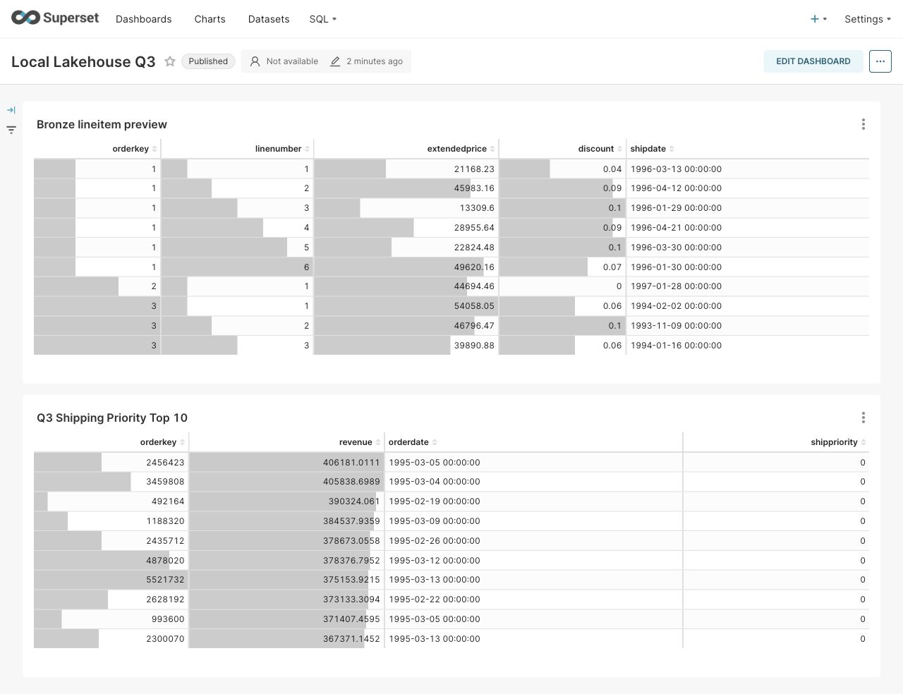
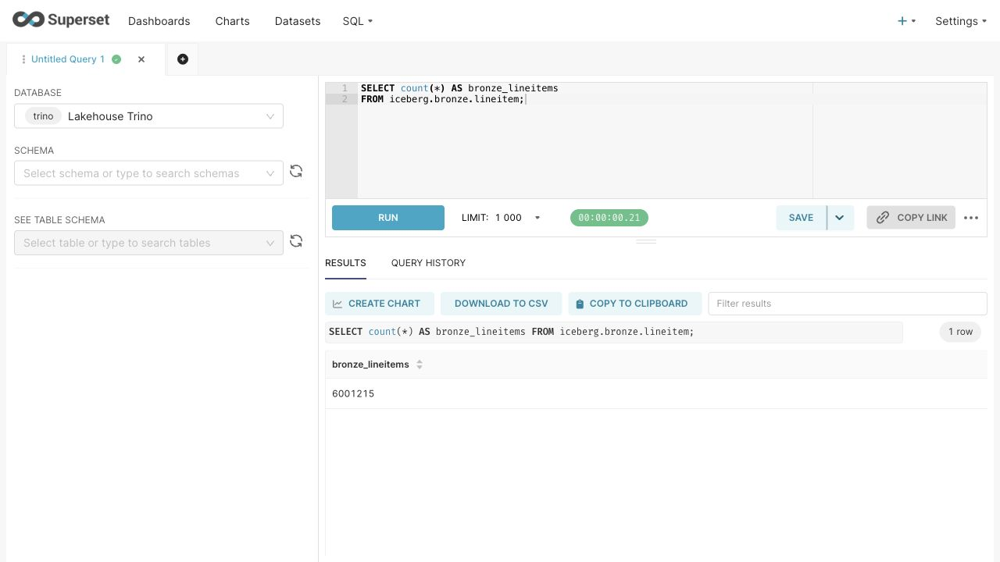
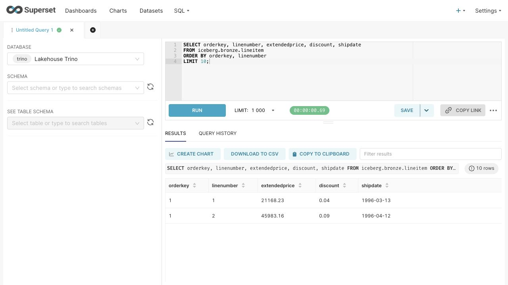

# Отчёт по практической работе №1

**Развертывание локального Lakehouse, ELT-преобразование и бенчмарк форматов и сжатия**.

## 1. Вариант и масштаб

| Поле | Значение |
| :---- | :---- |
| ФИО как в VK Education | Ровнягина Марина Александровна |
| Вариант | Вариант 1 - Q3 Shipping Priority |
| Масштаб | `sf1` |
| Почему выбран такой масштаб | Набор достаточно большой для демонстрации колоночного хранения, джойнов и агрегаций, но подходит для одного локального Docker-стенда. Паспортные количества TPC-H sf1 — 150 000 клиентов, 1 500 000 заказов и 6 001 215 строк заказов. Для изменения масштаба параметр `--scale` применяется одновременно к источнику, эталонному Q3 и всем сравниваемым копиям. |

## 2. Поднятые сервисы и почему именно они

Я развернула сервисы через Docker Compose в общей сети. Для хранения данных использованы постоянные Docker-тома; внешние HTTP-порты привязаны к `127.0.0.1`.

| Сервис | Роль в стеке | Почему выбран |
| :---- | :---- | :---- |
| MinIO | S3-совместимое объектное хранилище файлов данных и метаданных Iceberg | Позволяет воспроизвести S3-взаимодействие локально, без облачного аккаунта. В отличие от обычной папки проверяется работа объектного API. Используется закреплённая архивная сборка `bitnamilegacy/minio:2025.4.22`, содержащая сервер и клиент `mc`. |
| PostgreSQL 17.4 | Служебная БД каталога Lakekeeper | Транзакционное хранение состояния каталога и постоянный том упрощают воспроизводимость. Сами строки TPC-H находятся в MinIO, а не в PostgreSQL. |
| Lakekeeper 0.9.0 | Iceberg REST Catalog | Стандартный REST-интерфейс отделяет управление таблицами от вычислительного движка и позволяет подключать другие совместимые инструменты. Отдельный Hive Metastore для данного стенда не требуется. |
| Trino 484 | Генерация TPC-H, SQL-преобразования, чтение и запись Iceberg | В одном движке доступны источник `tpch`, джойны, агрегации и Iceberg-коннектор. Не нужно отдельно скачивать CSV или запускать генератор `dbgen`. |
| Apache Superset 4.1.2 | SQL Lab и дашборд над Bronze и Gold | Позволяет показать исходные строки и готовую витрину через SQL-доступ к существующим таблицам. Отдельный Spark-кластер для этой задачи добавил бы сложность. |
| minio-init | Одноразовое создание бакета | Подготавливает бакет `warehouse` до запуска каталога. |
| lakekeeper-migrate | Одноразовые миграции PostgreSQL | Исключает запуск Lakekeeper до подготовки служебной схемы БД. |

Superset отправляет SQL в Trino. Trino обращается за метаданными к Lakekeeper и читает либо записывает файлы напрямую в MinIO. Lakekeeper использует PostgreSQL для служебного состояния; Iceberg-снапшоты и файлы табличных метаданных находятся в объектном хранилище.

### Скрипты развертывания

Полная конфигурация находится в `docker-compose.yml`, настройки - в `config/`. Команды выполняются из корня проекта:

```bash
# Служебная БД, объектное хранилище, каталог и SQL-движок.
docker compose up -d --wait --wait-timeout 300 postgres minio lakekeeper trino
# Полный цикл: bootstrap Lakekeeper, warehouse lab, ELT, проверки и бенчмарк.
python3 scripts/lakehouse.py run --author "Ровнягина Марина Александровна" --scale sf1
# Проверка состояния основных и одноразовых контейнеров.
docker compose --profile bi ps -a
```

Superset поднимается общим скриптом после бенчмарка, чтобы BI-запросы не влияли на сравнение. Для локального стенда Trino использует явно заданные S3-ключи, а STS отключён. PostgreSQL, MinIO и Superset сохраняют состояние в разных томах. Учебные пароли находятся в конфигурации; стенд предназначен для локального использования.

Список и состояние контейнеров проверены командой `docker compose --profile bi ps -a`. Дополнительно общий скрипт проверяет доступность Trino, чтение Bronze, корректность Gold и подключение Superset. Состояние одноразовых контейнеров инициализации после успешного выполнения — `Exited (0)`; для них постоянная работа не требуется.

| Сервис | Результат проверки |
| :---- | :---- |
| PostgreSQL | Работает; проверка `pg_isready` успешна. |
| MinIO | Работает; бакет `warehouse` доступен. |
| Lakekeeper | Работает; warehouse `lab` создан. |
| Trino | Работает; `SELECT 1` и запросы к Iceberg выполняются. |
| Superset | Работает; SQL Lab читает Bronze, дашборд показывает Gold. |
| minio-init | Завершён с кодом 0. |
| lakekeeper-migrate | Завершён с кодом 0. |

## 3. Разбор запроса

Q3 считает выручку по заказам клиентов сегмента BUILDING, созданным до 15 марта 1995 года, по строкам с отгрузкой после этой даты. Затем выбираются 10 заказов с максимальной выручкой.

| Таблица TPC-H | Нужные колонки | Что делает запрос |
| :---- | :---- | :---- |
| `customer` | `custkey`, `mktsegment` | `custkey` связывает клиента с заказом, `mktsegment` используется для фильтра `BUILDING`. |
| `orders` | `orderkey`, `custkey`, `orderdate`, `shippriority` | Ключи нужны для джойнов; `orderdate` - для фильтра, группировки и вывода, `shippriority` для группировки и вывода. |
| `lineitem` | `orderkey`, `extendedprice`, `discount`, `shipdate`; дополнительно `linenumber` | `orderkey` связывает строку с заказом; цена и скидка участвуют в выручке; `shipdate` используется в фильтре. `linenumber` нужен для контроля уникальности строки по паре `(orderkey, linenumber)`. |

Использованы упрощённые имена колонок коннектора `tpch`, без префиксов таблиц. Условия фильтрации:

```sql
WHERE c.mktsegment = 'BUILDING'
  AND o.orderdate < DATE '1995-03-15'
  AND l.shipdate > DATE '1995-03-15'
```

## 4. Медальон

Во всех основных слоях выбраны Iceberg-таблицы с файлами PARQUET и сжатием ZSTD. Iceberg отвечает за таблицу, схему и снапшоты; PARQUET за представление данных в файлах; ZSTD за сжатие.

Размер задаётся в десятичных МБ: число байт / 1 000 000. Учитываются текущие data-файлы из метаданных `$files` с условием `content = 0`. Служебные файлы, предыдущие снапшоты и benchmark-копии не входят в размер основного слоя. Например:

```sql
SELECT count(*) AS data_files,
       coalesce(sum(file_size_in_bytes), 0) / 1000000.0 AS size_mb
FROM iceberg.bronze."lineitem$files"
WHERE content = 0;
```

### Bronze (сырой)

| Таблица | Оставленные колонки | Строк | Вес, МБ | Формат | Сжатие | Партиционирование | Обоснование |
| :---- | :---- | ----: | ----: | :---- | :---- | :---- | :---- |
| `bronze.customer` | `custkey`, `mktsegment` | 150 000 | 0,244307 | PARQUET | ZSTD | Нет | Сохранены ключ и сегмент, необходимые Q3. Для небольшой таблицы партиции добавили бы лишние файлы. |
| `bronze.orders` | `orderkey`, `custkey`, `orderdate`, `shippriority` | 1 500 000 | 6,984404 | PARQUET | ZSTD | Нет | Проекция уменьшает объём относительно полной исходной таблицы. Единая раскладка упрощает сравнение кодеков. |
| `bronze.lineitem` | `orderkey`, `linenumber`, `extendedprice`, `discount`, `shipdate` | 6 001 215 | 41,458757 | PARQUET | ZSTD | Нет | Сохранены поля запроса и составной ключ строки. Отсутствие партиций позволяет сравнивать кодеки при одинаковой файловой раскладке. |
| **Итого Bronze** | Три исходные проекции | **7 651 215** | **48,687468** | PARQUET | ZSTD | Нет | Размер равен сумме размеров трёх таблиц. |

### Silver (очищенный)

| Таблица | Колонки | Строк | Вес, МБ | Формат | Сжатие | Партиционирование | Обоснование |
| :---- | :---- | ----: | ----: | :---- | :---- | :---- | :---- |
| `silver.q3_lines` | `orderkey`, `linenumber`, `custkey`, `mktsegment`, `orderdate`, `shipdate`, `shippriority`, `extendedprice`, `discount`, `net_revenue` | 30 519 | 0,453352 | PARQUET | ZSTD | Нет | Получен отфильтрованный факт строк заказов. Денежная арифметика использует DECIMAL; для небольшой таблицы дополнительные партиции не обоснованы. |
| `silver.rejected_rows` | `source_table`, `row_id`, `reason` | 0 | 0,000000 | PARQUET | ZSTD | Нет | Некорректные значения фиксируются отдельно. Нулевой размер data-файлов не означает отсутствия Iceberg-метаданных. |

На Silver сегмент нормализован через `upper(trim(mktsegment))`. Проверяются обязательные поля, положительные ключи, неотрицательная цена и скидка в диапазоне от 0 до 1. Джойны обогащают строку атрибутами клиента и заказа, затем применяются фильтры Q3. Дубликаты ключей и нарушенные внешние ключи не скрываются: соответствующая проверка останавливает полный прогон.

Цена приведена к `DECIMAL(15,2)`, скидка к `DECIMAL(4,2)`.  
Вычисление: extendedprice * (DECIMAL '1.00' - discount) AS net_revenue  
сохраняет четыре знака после запятой и позволяет избежать накопления двоичной ошибки при суммировании.

### Gold (витрина)

| Таблица | Колонки | Строк | Вес, МБ | Формат | Сжатие | Партиционирование | Обоснование |
| :---- | :---- | ----: | ----: | :---- | :---- | :---- | :---- |
| `gold.q3_shipping_priority` | `orderkey`, `revenue`, `orderdate`, `shippriority` | 10 | 0,000841 | PARQUET | ZSTD | Нет | Компактная витрина по заказам. Для 10 строк единообразие хранения полезнее дробления на партиции; существенную долю размера составляют накладные расходы файла. |

Витрина построена следующим запросом:

```sql
CREATE TABLE iceberg.gold.q3_shipping_priority
WITH (
    format = 'PARQUET',
    compression_codec = 'ZSTD',
    format_version = 2
)
AS
SELECT orderkey,
       sum(net_revenue) AS revenue,
       orderdate,
       shippriority
FROM iceberg.silver.q3_lines
GROUP BY orderkey, orderdate, shippriority
ORDER BY revenue DESC, orderdate, orderkey
LIMIT 10;
```

## 5. Тесты производительности

### Параметры стенда

| Параметр | Значение |
| :---- | :---- |
| Операционная система | macOS 15.3, ARM64 (Apple M4); контейнеры — Linux в Docker Desktop |
| Вычислительные ресурсы | Apple M4, 10 ядер CPU, 16 ГБ RAM |
| Ресурсы Docker | 10 CPU, 7,65 ГиБ RAM |
| Локальный диск | SSD |
| Python | 3.14.3 |
| Конфигурация Trino | Один координатор, выполняющий также задачи обработки |
| Максимальная Java-куча Trino | 4 ГБ |
| Лимит памяти контейнера Trino | 5 ГБ |
| Масштаб | sf1 |
| Повторы записи | 3 измеряемых раунда после прогрева |
| Повторы Q3 | 5 измеряемых выполнений после одного прогрева каждой пары |
| Идентификатор запуска | `20261017T154656998167Z` |

### Методика сравнения

Для каждой пары формата и кодека я создала отдельные физические копии трёх таблиц Bronze с одинаковыми колонками, масштабом и отсутствием партиционирования. Настройка сжатия применялась при новой записи файлов; простая смена свойства существующей таблицы без перезаписи не использовалась.

Сначала выполнен прогрев записи всех вариантов, затем три раунда пересоздания каждой тройки Bronze. Время записи раунда - сумма серверных времён трёх CTAS, DROP, контрольные проверки и получение размеров в неё не входят. Время включает генерацию TPC-H, сериализацию, передачу в MinIO и commit Iceberg.

Перед измерением Q3 выполнен один прогрев каждой пары, после него пять измеряемых выполнений. Итоговое время медиана пяти серверных значений `elapsedTimeMillis`. Q3 читал непосредственно сравниваемые таблицы Bronze и выполнял исходные джойны, фильтры и агрегацию; чтение готового Gold не использовалось как замена Q3.

Порядок пар перемешивался в каждом раунде с `seed=42`. Все запросы выполнялись последовательно; Superset на время бенчмарка был остановлен. Кэши ОС и MinIO принудительно не очищались, поэтому сравнение относится к прогретому режиму. Размер Bronze определялся по сумме текущих data-файлов трёх таблиц; итог - медиана размеров трёх раундов.

После каждой записи COUNT и checksum всех сохранённых полей сравнивались с источником. Каждый результат Q3 сверялся с эталонным запросом на `tpch.sf1`. Дополнительно сохранены min/max, стандартное отклонение времени Q3, клиентское время и статистики движка.

### Сравнение сжатия на Bronze

Один формат PARQUET позволяет сравнить кодеки. Все числа ниже — фактические замеры этого запуска.

| Сжатие на Bronze | Q3, медиана с | Размер Bronze, медиана МБ |
| --- | --- | --- |
| GZIP | 0,583 | 48,897 |
| ZSTD | 0,373 | 48,630 |

При переходе с GZIP на ZSTD время Q3 изменилось на -36,0%, время записи — на -52,0%, размер — на -0,5%. Отрицательное значение означает уменьшение.

### Сравнение форматов и времени записи

| Формат | Сжатие | Запись Bronze, медиана с | Q3, медиана с | Размер Bronze, медиана МБ |
| --- | --- | --- | --- | --- |
| PARQUET | GZIP | 5,022 | 0,583 | 48,897 |
| PARQUET | ZSTD | 2,409 | 0,373 | 48,630 |
| ORC | ZSTD | 2,783 | 0,394 | 54,234 |

Минимальная медиана Q3 получена для **PARQUET/ZSTD**, записи — для **PARQUET/ZSTD**, минимальный размер — для **PARQUET/ZSTD**. Основные слои используют заранее выбранный PARQUET/ZSTD. Измерения не доказывают его универсального преимущества; выводы относятся к данному стенду и масштабу sf1.

### Повторы и разброс результатов

| Вариант | Пять времён Q3, с | Медиана Q3, с | Min–max Q3, с | Выборочное стандартное отклонение, с |
| --- | --- | --- | --- | --- |
| PARQUET/GZIP | 0,583; 0,600; 0,608; 0,456; 0,477 | 0,583 | 0,456–0,608 | 0,072 |
| PARQUET/ZSTD | 0,370; 0,373; 0,438; 0,343; 0,399 | 0,373 | 0,343–0,438 | 0,036 |
| ORC/ZSTD | 0,394; 0,753; 0,436; 0,385; 0,389 | 0,394 | 0,385–0,753 | 0,159 |

| Вариант | Три времени записи Bronze, с | Медиана записи, с |
| --- | --- | --- |
| PARQUET/GZIP | 5,022; 4,896; 6,504 | 5,022 |
| PARQUET/ZSTD | 2,305; 2,409; 2,478 | 2,409 |
| ORC/ZSTD | 2,598; 4,223; 2,783 | 2,783 |

Сырые результаты, серверные query_id и статистики сохранены в `results/20261017T154656998167Z/`: `query_runs.csv`, `write_runs.csv`, `size_runs.csv`, `benchmark_summary.csv`, `queries.jsonl`. Размер основного Bronze и медиана размеров benchmark-копий могут немного различаться из-за файловой раскладки.

## 6. Часть 2 — осмысление и работа с инструментами

### 6.1. Понять и объяснить

| Вопрос | Ответ |
| :---- | :---- |
| Зачем большие данные и lakehouse, а не обычная БД или хранилище? | Lakehouse позволяет хранить большой объём исходных и исторических данных в объектном хранилище и независимо подключать вычислительные движки. Открытый табличный формат добавляет к файлам управляемую схему, атомарные изменения и снапшоты. Это полезно для аналитических сканирований, повторной обработки и совместного доступа. Для небольшого OLTP с частыми одиночными изменениями PostgreSQL обычно проще. |
| Schema evolution на Silver: добавление и переименование колонки | Для опыта создана копия `silver.evolution_demo` из 1000 строк. Добавлена колонка `quality_note VARCHAR`, затем переименована в `dq_note`. Для прежних строк новое поле читалось как NULL. Пути и размеры data-файлов до и после совпали: изменились метаданные схемы без перезаписи данных. |
| Пример скрипта восстановления данных из снапшота (time travel) | Перед удалением данных демонстрационной таблицы сохранён snapshot ID `757705280548165639`. Time travel прочитал эту версию, rollback восстановил данные; количество строк и checksum после восстановления совпали с исторической версией. Скрипт приведён ниже. |

Пример изменения схемы:

```sql
ALTER TABLE iceberg.silver.evolution_demo
ADD COLUMN quality_note VARCHAR;
ALTER TABLE iceberg.silver.evolution_demo
RENAME COLUMN quality_note TO dq_note;
```

Пример восстановления из сохранённого снапшота:

```sql
-- Снимки демонстрационной таблицы.
SELECT snapshot_id, committed_at, operation
FROM iceberg.silver."evolution_demo$snapshots"
ORDER BY committed_at DESC;
-- Чтение сохранённой версии через time travel.
SELECT count(*) AS row_count,
       to_hex(checksum(ROW(orderkey, linenumber, net_revenue))) AS data_checksum
FROM iceberg.silver.evolution_demo
FOR VERSION AS OF 757705280548165639;
-- Восстановление текущего состояния таблицы.
ALTER TABLE iceberg.silver.evolution_demo
EXECUTE rollback_to_snapshot(757705280548165639);
-- Контроль после восстановления.
SELECT count(*) AS row_count,
       to_hex(checksum(ROW(orderkey, linenumber, net_revenue))) AS data_checksum
FROM iceberg.silver.evolution_demo;
```

Результаты опыта:

| Этап | Количество строк | Проверка |
| :---- | ----: | :---- |
| До демонстрационного удаления | 1000 | Сохранён snapshot ID `757705280548165639`. |
| После удаления | 0 | Текущая версия таблицы пуста. |
| Чтение сохранённого снимка через time travel | 1000 | Исторические данные доступны. |
| После `rollback_to_snapshot` | 1000 | Количество строк и checksum совпали с сохранённой версией. |

Опыт выполнялся только на демонстрационной копии; основные Bronze, Silver и Gold не удалялись. Time travel прочитал историческую версию без изменения текущей таблицы, а rollback перевёл текущую таблицу на сохранённый снимок. Откат схемы этим опытом не проверялся. Снапшоты не заменяют резервную копию: необходимые data-файлы должны оставаться в хранилище.

### 6.2. Подключить инструмент к Lakehouse

| Инструмент | Почему выбран |
| :---- | :---- |
| Apache Superset 4.1.2 | Позволяет в SQL Lab показать данные именно Bronze и дополнительно вывести Gold на дашборд. Через Trino используется тот же каталог и те же файлы; отдельная копия данных в BI-хранилище не создаётся. |

Superset развернут отдельным контейнером. В образ добавлен драйвер `trino[sqlalchemy]==0.333.0`; задана строка подключения:

```text
trino://bi@trino:8080/iceberg
```

Скрипты развертывания находятся в `config/superset/`: `Dockerfile`, `start.sh`, `create_admin.py`, `superset_config.py` и `register.py`.

Общий запуск автоматически настроил инструмент. Для подключения и регистрации datasets использованы команды:

```bash
docker compose --profile bi up -d --build --wait --wait-timeout 600 superset
docker compose exec -T -e EVIDENCE_RUN_ID=20261017T154656998167Z superset python /app/pythonpath/register.py
```

Идентификатор всего запуска — `20261017T154656998167Z`; соответствующий каталог результатов — `results/20261017T154656998167Z/`. Он отличается от числового snapshot ID `757705280548165639`, обозначающего версию одной Iceberg-таблицы.

Действия в UI:

1. Открыт `http://localhost:8088`, выполнен вход `admin` / `admin-local`.  
2. В SQL Lab выбрана база `Lakehouse Trino`.  
3. Выполнены подсчёт строк Bronze и просмотр исходных строк.  
4. Открыт дашборд `/superset/dashboard/q3-lakehouse/` с Bronze preview и Gold top 10.

Запросы для демонстрации:

```sql
SELECT count(*) AS bronze_lineitems
FROM iceberg.bronze.lineitem;
```

Для загруженного без потерь TPC-H sf1 ожидается 6 001 215 строк.

```sql
SELECT orderkey, linenumber, extendedprice, discount, shipdate
FROM iceberg.bronze.lineitem
ORDER BY orderkey, linenumber
LIMIT 10;
```

```sql
SELECT orderkey, revenue, orderdate, shippriority
FROM iceberg.gold.q3_shipping_priority
ORDER BY revenue DESC, orderdate, orderkey;
```

Скрипт `register.py` выполнил запрос к Bronze из BI-контейнера: число строк `lineitem` — 6 001 215, просмотрено 10 исходных строк. На дашборде отображены 10 строк Bronze preview и 10 заказов Gold. Консольное подтверждение подключения и SQL записаны в `results/20261017T154656998167Z/bi_proof.json`.

## 7. Выводы

Медальон разделил исходные проекции Bronze, проверенный факт Silver и витрину Gold. Bronze содержит 7 651 215 строк в трёх таблицах и занимает 48,687468 МБ; Silver Q3 содержит 30 519 строк, Gold — 10 заказов. Выручка и состав Gold совпали с эталонным Q3 на tpch.sf1 с допуском 0,0001 для сравнения DECIMAL и DOUBLE.

По фактическим медианам Q3 быстрее PARQUET/ZSTD, запись быстрее у PARQUET/ZSTD, наименьший размер у PARQUET/ZSTD. При выборе PARQUET/ZSTD для основных слоёв учитывалась единообразная конфигурация; результаты бенчмарка приведены отдельно и не подгонялись под этот выбор. Из-за прогретых кэшей и одного локального стенда сравнение не является универсальной оценкой форматов.

Schema evolution не изменил пути и размеры data-файлов. Time travel и rollback восстановили 1000 строк демонстрационной таблицы, количество и checksum совпали. Superset подключён к Bronze и Gold; консольное подтверждение находится в `bi_proof.json`.

## Материалы фактического запуска

- Run ID: `20261017T154656998167Z`.
- Warehouse ID Lakekeeper: `6cc465d2-ca3d-11f1-8885-4f9d58b1e547`.
- Snapshot ID демонстрационной таблицы: `757705280548165639`.
- Проверки: 20 из 20 успешны (`validation.json`).
- Результаты: `results/20261017T154656998167Z/`; версия Docker, параметры среды, идентификаторы образов и SQL сохранены рядом.

## Скриншоты фактического запуска

Дашборд с Bronze preview и Gold Top 10:



Подсчёт Bronze lineitem в SQL Lab:



Просмотр исходных строк в SQL Lab:


